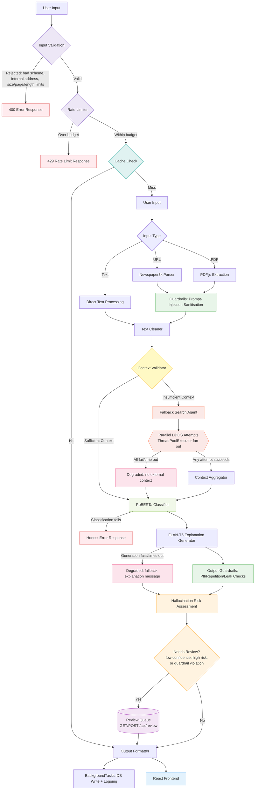

# InformaTruth: AI-Driven News Authenticity Analyzer
[](https://github.com/Md-Emon-Hasan/InformaTruth/actions) [](https://python.org) [](https://pytorch.org/) [](https://huggingface.co/) [](https://python.langchain.com/) [](https://scikit-learn.org/) [](https://pandas.pydata.org/) [](https://fastapi.tiangolo.com) [](https://www.docker.com/)  

InformaTruth is an end-to-end AI-powered multi-agent fact-checking system that automatically verifies news articles, PDFs, and web content. It leverages RoBERTa fine-tuning, LangGraph orchestration, and a DuckDuckGo fallback retrieval agent to deliver context-aware verification. The system features a modular multi-agent architecture - `Planner`, `InputHandler`, `Router`, `Executor`, and `FallbackSearch` - each a distinct LangGraph node.

On top of the core pipeline, InformaTruth adds four production-hardening layers: **prompt-injection & output guardrails**, **heuristic hallucination-risk detection** (reusing FLAN-T5, no extra model), **parallelised fallback search** for lower latency on retries, and a **human-in-the-loop review queue** for flagged results. On the LIAR test split the classifier reaches **64.46% accuracy and 0.6351 macro-F1**, ahead of a TF-IDF + logistic-regression baseline trained on the same data (0.6025 macro-F1) (see [Model Performance](#model-performance) below). Designed for real-world deployment, InformaTruth includes a React + Vite + Tailwind CSS responsive UI, FastAPI endpoints, Dockerized containers, and a CI/CD pipeline.

---

## Fine Tuned LLM

[](https://huggingface.co/emonHasan01/liar-roberta)

---

[](https://github.com/user-attachments/assets/423ca9a1-caf1-405e-b671-be842d9a1240)

[](https://github.com/user-attachments/assets/1e6717bc-53a3-4848-80a8-252c4eae8f5b)
[](https://github.com/user-attachments/assets/187a8cc1-75dc-46c5-809a-8d88214797e4)

---

## Live Demo

**Try it now**: [InformaTruth — Fake News Detection AI App](https://informatruth.onrender.com)

---

## Tech Stack
| **Category**                | **Technology/Resource**                                                                                |
| --------------------------- | ------------------------------------------------------------------------------------------------------ |
| **Core Framework**          | PyTorch, Transformers, HuggingFace                                                                     |
| **Frontend Framework**      | **React.js**, Tailwind CSS                                                             |
| **Backend Framework**       | **FastAPI** (Async, Pydantic)                                                                          |
| **Classification Model**    | Fine-tuned RoBERTa-base on LIAR Dataset                                                                |
| **Explanation Model**       | FLAN-T5-base (Zero-shot Prompting)                                                                     |
| **Training Data**           | LIAR Dataset (Political Fact-Checking)                                                                 |
| **Evaluation Metrics**      | Accuracy, Precision, Recall, F1-score                                                                  |
| **Training Framework**      | HuggingFace Trainer                                                                                    |
| **LangGraph Orchestration** | LangGraph (Multi-Agent Directed Acyclic Execution Graph)                                               |
| **Agents Used**             | `Planner`, `InputHandler`, `Router`, `Executor` (classification + explanation + hallucination check), `FallbackSearch` |
| **Input Modalities**        | Raw Text, Website URLs (via Newspaper3k), PDF Documents (via PyMuPDF)                                  |
| **Tool Augmentation**       | DuckDuckGo Search API (Fallback), Wikipedia (Planned), ToolRouter Logic                                |
| **Web Scraping**            | Newspaper3k (HTML → Clean Article)                                                                     |
| **PDF Parsing**             | PyMuPDF (Backend) / PDF.js (Frontend)                                                                  |
| **Explainability**          | Natural language justification generated using FLAN-T5                                                 |
| **State Management**        | Shared State Object (LangGraph-compatible)                                                             |
| **Hosting Platform**        | Render (Docker)                                                                                        |
| **Version Control**         | Git, GitHub                                                                                            |
| **Logging & Debugging**     | Centralized Logs in `logs/` directory                                                                  |
| **Database**                | **SQLite** + **SQLModel** (Auto-persistence of analysis results)                                       |
| **Input Support**           | Text, URLs, PDF documents                                                                              |
| **Caching**                  | `cachetools` TTLCache, three independent layers (URL/classification/search), thread-safe in-memory     |
| **Rate Limiting**           | `slowapi`, proxy-aware keying (`X-Forwarded-For`)                                                       |
| **Resilience**               | Per-component graceful degradation (FLAN-T5, DuckDuckGo) with explicit timeouts                        |
| **Guardrails**               | Custom regex/heuristic prompt-injection sanitiser + output PII/repetition/leak checks (stdlib only, no new model) |
| **Hallucination Detection**  | Heuristic signals - verdict-consistency, capitalised-token grounding, opt-in FLAN-T5 self-consistency resampling (no new model) |
| **Concurrency**              | `concurrent.futures.ThreadPoolExecutor` fan-out for DuckDuckGo fallback-search retries (RoBERTa/FLAN-T5 inference stays single-threaded) |
| **Human-in-the-Loop**        | SQLModel-backed review queue (`needs_review`/`review_status`/`human_verdict` columns), unauthenticated  |

---

## Key Features

* **Monolithic & Agentic Architecture**
  Strictly organized codebase following agentic principles with modular separation of concerns.

* **Modern React Frontend**
  A responsive, pixel-perfect UI built with **React**, **Vite**, and **Tailwind CSS**, featuring dark mode and glassmorphism design.

* **FastAPI Backend**
  High-performance asynchronous API handling automatic documentation and efficient model serving.

* **Multi-Format Input Support**
  Accepts raw **text**, **web URLs**, and **PDF documents** (with client-side text extraction).

* **Full NLP Pipeline**
  Integrates **fake news classification** (RoBERTa) and **natural language explanation** (FLAN-T5).

* **Modular Agent-Based Architecture**
  Built using **LangGraph** with modular agents: `Planner`, `Router`, `Executor`, and `Fallback`.

* **Explanation Generation**
  Uses **FLAN-T5** to generate human-readable rationales for model predictions.

* **Prompt-Injection & Output Guardrails**
  Scraped URL/PDF text is sanitised for instruction-like content (fake system delimiters, "ignore previous instructions", role markers) before it reaches any FLAN-T5 prompt.

* **Hallucination Risk Detection**
  A capitalised-token grounding heuristic against the source text, and an opt-in FLAN-T5 self-consistency resample - combine into a `hallucination_risk: low | medium | high` field on every response.

* **Parallel Fallback Search**
  DuckDuckGo fallback-search retries fan out concurrently via a persistent `ThreadPoolExecutor` with a bounded per-branch timeout, instead of running sequentially.

* **Human-in-the-Loop Review Queue**
  A human verdict is recorded alongside - never overwriting - the model's own prediction, and `/api/stats` reports the model-vs-human agreement rate.

* **Comprehensive Testing**
  173 backend tests with 100% statement and branch coverage (`pytest --cov=app --cov-branch`), plus a `vitest` suite on the frontend.

* **Structured Logging**
  All logs are automatically saved to the `logs/` directory for better debugging and monitoring.

* **Multi-Layer Caching**
  Independent, thread-safe in-memory TTL caches for URL text, classification results, and search results - skips redundant Newspaper3k downloads, RoBERTa inference, and DuckDuckGo calls.

* **Rate Limiting**
  Per-endpoint, per-input-type request limits (`slowapi`) keyed by the real client IP behind the deployment proxy.

* **Input Validation & Safety Limits**
  Text length/content checks, PDF size/page caps enforced before parsing, and URL scheme + internal-address (SSRF) protection.

* **Graceful Degradation**
  A failed explanation or search never fails a successful classification - the response still returns with a `degraded` flag instead.

* **Analysis History & Statistics**
  `GET /api/history` and `GET /api/stats` expose the previously write-only analysis log for pagination, filtering, and aggregate reporting.

---

## Model Performance

Every number below comes from the single fine-tuning run that produced the released weights, evaluated on the held-out LIAR test split.

### Results

| | Accuracy | Macro F1 | F1 (Fake) | Precision (Fake) | Recall (Fake) | ROC AUC |
|---|---|---|---|---|---|---|
| Majority class | 0.6415 | 0.3908 | — | — | — | — |
| TF-IDF + LogReg | 0.6220 | 0.6025 | 0.6905 | 0.7272 | 0.6574 | 0.6496 |
| **RoBERTa (this model)** | **0.6446** | **0.6351** | **0.6940** | **0.7751** | **0.6282** | **0.6959** |

The majority-class row is there on purpose: accuracy alone says very little on this dataset, since always answering `Fake` already scores 0.6415. The real gain over the TF-IDF baseline shows up in macro-F1 and ROC AUC, not in headline accuracy.

The binary collapse leaves the data imbalanced - 460 Real against 823 Fake in the test split - so training used class-weighted cross-entropy and the checkpoint was chosen on macro-F1 rather than accuracy.

At the default 0.5 cutoff the model is precision-leaning on the fake class (0.7751 precision against 0.6282 recall): when it flags something as fake it is usually right, but a sizeable share of fake statements still get through.

### Where it succeeds and fails

Accuracy across the six original LIAR classes, before the binary collapse:

| LIAR class | Mapped to | n | Accuracy | Mean P(Fake) |
|---|---|---|---|---|
| `false` | Fake | 250 | 0.652 | 0.586 |
| `half-true` | Fake | 267 | 0.532 | 0.534 |
| `mostly-true` | Real | 249 | 0.663 | 0.456 |
| `true` | Real | 211 | 0.687 | 0.449 |
| `barely-true` | Fake | 214 | 0.668 | 0.594 |
| `pants-fire` | Fake | 92 | 0.750 | 0.639 |

The ends of the scale are separable; the middle is not. `half-true` and `mostly-true` differ by an editorial judgement that is largely unrecoverable from 18 words of text, and the model's mean probabilities on those two classes (0.534 and 0.456) sit right on the decision boundary.

Of 456 errors, 150 are real statements flagged as fake and 306 are fake statements let through.

### Most confident mistakes

| LIAR class | True | Predicted | Confidence | Statement |
|---|---|---|---|---|
| `true` | Real | Fake | 0.90 | "Obama has more czars than the Romanovs." |
| `true` | Real | Fake | 0.88 | The words subhuman mongrel, which Ted Nugent called President Barack Obama, were used by the Na… |
| `mostly-true` | Real | Fake | 0.88 | Obama-Nelson economic record: Job creation … at slowest post-recession rate since Great Depre… |

Each of these is a true statement written in a rhetorically charged register - the model is reading style, not evidence.

### Choosing a threshold

`P(Fake)` is exposed, so the 0.5 cutoff is a starting point rather than a verdict:

| Threshold | Precision (Fake) | Recall (Fake) | F1 | Share flagged |
|---|---|---|---|---|
| 0.20 | 0.642 | 1.000 | 0.782 | 99.9% |
| 0.30 | 0.669 | 0.939 | 0.782 | 90.0% |
| 0.40 | 0.733 | 0.785 | 0.758 | 68.7% |
| 0.50 | 0.775 | 0.628 | 0.694 | 52.0% |
| 0.60 | 0.796 | 0.485 | 0.603 | 39.0% |
| 0.70 | 0.835 | 0.301 | 0.443 | 23.1% |
| 0.80 | 0.884 | 0.139 | 0.239 | 10.1% |

F1 peaks around 0.30-0.40 rather than at the default 0.50. At threshold 0.65 precision reaches 0.811, with recall falling to 0.385.

### Is the confidence meaningful?

Expected calibration error is **0.042** over 10 bins, with the reliability curve below the diagonal - the model is overconfident, so when it says 0.9 it is right less often than 90% of the time. Treat the score as a ranking signal, not as a probability of being lied to.

### Training setup

| | |
|---|---|
| Base model | `roberta-base`, 125M parameters, all trained |
| Objective | Class-weighted cross-entropy (weights 1.41, 0.78) |
| Max length | 128 tokens |
| Learning rate | 2e-5, AdamW, 10% warmup |
| Batch size | 16 |
| Epochs | 3, best checkpoint by validation macro-F1 |
| Weight decay | 0.01 |
| Seed | 42 |
| Hardware | Tesla T4 |

Statement length in the training set is a median of 22 tokens with a 95th percentile of 40, so the 128-token window truncates almost nothing.

### LIAR Label Mapping

The LIAR dataset's six original truthfulness labels are collapsed into the binary target the classifier is actually trained on, per `backend/train/data_loader.py`:

| LIAR Label    | Binary Target |
| ------------- | ------------- |
| `mostly-true` | Real (`0`)    |
| `true`        | Real (`0`)    |
| `pants-fire`  | Fake (`1`)    |
| `false`       | Fake (`1`)    |
| `barely-true` | Fake (`1`)    |
| `half-true`   | Fake (`1`)    |

`Precision (Fake)` / `Recall (Fake)` in the tables above refer to this derived positive class (`1`) - note that `half-true` is grouped with the fake side of the split, not the real side.

---

## Project File Structure

```bash
InformaTruth/
│
├── .github/
│   └── workflows/
│       └── main.yml                  # CI/CD Configuration
│
├── backend/                          # FastAPI Backend
│   ├── app/                          # Application Package
│   │   ├── agents/                   # Modular Pipeline Agents
│   │   │   ├── executor.py
│   │   │   ├── fallback_search.py
│   │   │   ├── input_handler.py
│   │   │   ├── planner.py
│   │   │   └── router.py
│   │   ├── graph/                    # LangGraph Orchestration
│   │   │   ├── builder.py
│   │   │   └── state.py
│   │   ├── models/                   # AI Model Wrappers
│   │   │   ├── classifier.py
│   │   │   ├── db.py                 # Database Models
│   │   │   └── loader.py
│   │   ├── utils/                    # Shared Utilities
│   │   │   ├── cache.py              # Multi-layer TTL caching
│   │   │   ├── guardrails.py         # Prompt-injection sanitisation + output safety checks (Phase 1)
│   │   │   ├── hallucination.py      # Hallucination-risk signals, reuses FLAN-T5 (Phase 2)
│   │   │   ├── logger.py
│   │   │   ├── results.py
│   │   │   └── validation.py         # Text/URL/PDF input validation
│   │   ├── db.py                     # Database connection, setup, and column migration
│   │   └── main.py                   # FastAPI entry point
│   ├── liar_dataset/                 # Raw LIAR TSV splits
│   │   └── valid.tsv
│   ├── logs/                         # Application Logs
│   │   └── fake_news_pipeline.log
│   ├── news/                         # Sample Data
│   │   └── news.pdf
│   ├── scripts/
│   │   └── benchmark_fallback_search.py  # Sequential vs. concurrent search benchmark (Phase 3)
│   ├── tests/                        # Backend Tests (173 tests, 100% statement/branch coverage)
│   │   ├── conftest.py
│   │   ├── test_agents.py
│   │   ├── test_api.py
│   │   ├── test_api_extra.py
│   │   ├── test_app.py
│   │   ├── test_background_tasks.py  # BackgroundTasks persistence
│   │   ├── test_cache.py             # Multi-layer caching
│   │   ├── test_db.py                # Database integration + schema migration
│   │   ├── test_degradation.py       # Graceful degradation
│   │   ├── test_edge_cases.py
│   │   ├── test_executor.py
│   │   ├── test_graph.py
│   │   ├── test_guardrails.py        # Prompt-injection + output guardrails (Phase 1)
│   │   ├── test_hallucination.py     # Hallucination-risk signals (Phase 2)
│   │   ├── test_history_stats.py     # /api/history & /api/stats
│   │   ├── test_lifespan.py
│   │   ├── test_model_info.py        # /api/model-info metadata
│   │   ├── test_models.py
│   │   ├── test_parallel_search.py   # Concurrent fallback search (Phase 3)
│   │   ├── test_rate_limit.py        # Rate limiting
│   │   ├── test_results.py
│   │   ├── test_review.py            # Human-in-the-loop review queue (Phase 4)
│   │   ├── test_utils.py
│   │   └── test_validation.py        # Input validation
│   ├── train/                        # Training module
│   │   ├── config.py
│   │   ├── data_loader.py
│   │   ├── predictor.py
│   │   ├── run.py
│   │   ├── trainer.py
│   │   └── utils.py
│   ├── config.py                     # Global configuration (see Configuration section below)
│   ├── Dockerfile                    # Backend Dockerfile
│   ├── pyproject.toml                # Project Configuration
│   ├── requirements.txt              # Python dependencies
│   └── setup.py                      # Package Setup
│
├── frontend/                         # React Frontend
│   ├── public/                       # Static Assets
│   ├── src/                          # Source Code
│   │   ├── assets/                   # Images/Vectors
│   │   │   └── react.svg
│   │   ├── components/               # React Components
│   │   │   ├── AnalysisForm.jsx
│   │   │   ├── Footer.jsx
│   │   │   ├── Hero.jsx
│   │   │   ├── Navbar.jsx
│   │   │   └── ResultsParams.jsx
│   │   ├── App.jsx                   # Main App Component
│   │   ├── App.test.jsx              # Frontend Unit Tests
│   │   ├── index.css                 # Tailwind
│   │   ├── main.jsx                 
│   │   └── setupTests.js             
│   ├── Dockerfile                    # Frontend Dockerfile
│   ├── eslint.config.js            
│   ├── index.html                    # HTML Entry Point
│   ├── package-lock.json           
│   ├── package.json                 
│   └── vite.config.js                # Vite Configuration
│
├── docker-compose.yml                # Docker Orchestration
├── demo.mp4                          # Demo Video
├── demo-1.png                        # Demo Image
├── demo-2.png                        # Demo Image
├── LICENSE                           # Project License
├── README.md                         # Documentation
├── render.yml                        # Render Deployment Config
└── run.py                            # Root launch script
```

---

## System Architecture


---

## Getting Started

### 1. Running the Application (Local Development)
To launch both the **FastAPI Backend** and **React Frontend** locally in parallel:
```bash
python run.py
```
- **Backend**: `http://localhost:8000`
- **Frontend**: `http://localhost:5173`

### 2. Running with Docker (Production/Containerized)
To build and run the entire stack using Docker Compose:
```bash
docker-compose up --build
```

### 3. Running Training
To trigger the model training process (ensure you are in `backend/`):
```bash
cd backend
python train/run.py
```

### 4. Running Tests
**Backend (Pytest):**
```bash
cd backend
python -m pytest tests/ --cov=app --cov-branch --cov-report=term-missing
```

---

## API Endpoints

| Method | Path              | Description                                                        | Rate Limit                | Cache Behaviour                                                        |
| ------ | ----------------- | -------------------------------------------------------------------| -------------------------- | ------------------------------------------------------------------------ |
| POST   | `/analyze`        | Classifies text, a URL, or a PDF; returns a verdict, explanation, `guardrails`, `hallucination_risk`/`hallucination_details`, and `needs_review` | 10/min (text), 5/min (URL), 5/min (PDF) - independent per-type budgets | URL text, classification, and search results each read/write their own cache layer |
| GET    | `/api/history`    | Paginated log of past analyses, with filters                       | 60/minute                  | Not cached (always reads current DB state)                              |
| GET    | `/api/review`     | Paginated queue of analyses flagged `needs_review` (pending only), reuses `/api/history`'s pagination/filtering helpers | 60/minute | Not cached (always reads current DB state) |
| POST   | `/api/review/{id}` | Records a human verdict on a flagged analysis, alongside (never overwriting) the model's own label/confidence | 20/minute | Not cached (write path) |
| GET    | `/api/stats`      | Aggregate statistics over the analysis log, including review-queue counts and model-vs-human agreement rate | 60/minute | Not cached, but includes live `cache_stats()` in the response           |
| GET    | `/api/model-info` | Static model/config metadata                                       | Unlimited                  | Not cached (trivially cheap to compute)                                 |

All limits are configurable via environment variables and disabled entirely when `RATE_LIMIT_ENABLED=false`. See [Configuration](#configuration) below for the full list of config variables.

---

## Professional Testing & Quality

### 1. Linting
**Backend (Ruff):**
```bash
cd backend
ruff check app/ tests/
```
**Frontend (ESLint):**
```bash
cd frontend
npm run lint
```

### 2. Code Formatting
**Backend (Black):**
```bash
cd backend
black app/ tests/
```

### 3. Backend Test Suite

173 tests, 100% statement and 100% branch coverage (`pytest --cov=app --cov-branch --cov-report=term-missing`). No `# pragma: no cover` markers were needed.

---

## Limitations

- **The classifier is stylistic, not evidence-based.** 
- **Hallucination-risk thresholds are unvalidated heuristics.**
- **The grounding heuristic is a capitalised-token proxy, not NER.**

---

## **Developed By**

**Md Emon Hasan**  
**Email:** emon.mlengineer@gmail.com  
**Portfolio:** [Md-Emon-Hasan](https://emonlabs-ai.hitechparks.com/)  
**WhatsApp:** [+8801834363533](https://wa.me/8801834363533)  
**GitHub:** [Md-Emon-Hasan](https://github.com/Md-Emon-Hasan)  
**LinkedIn:** [Md Emon Hasan](https://www.linkedin.com/in/md-emon-hasan-695483237/)  
**Facebook:** [Md Emon Hasan](https://www.facebook.com/mdemon.hasan2001/)

---

## License
MIT License. Free to use with credit.
